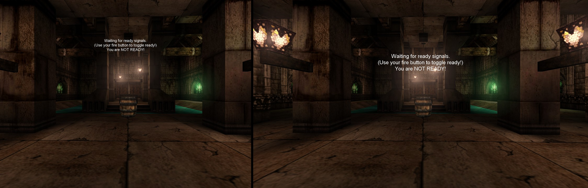
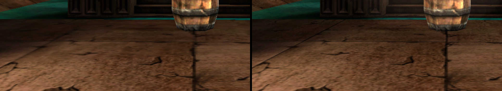
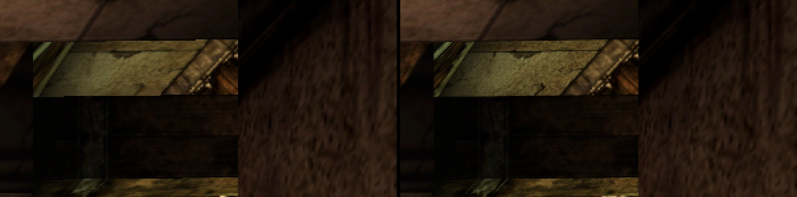
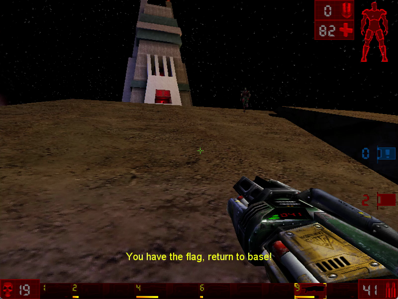
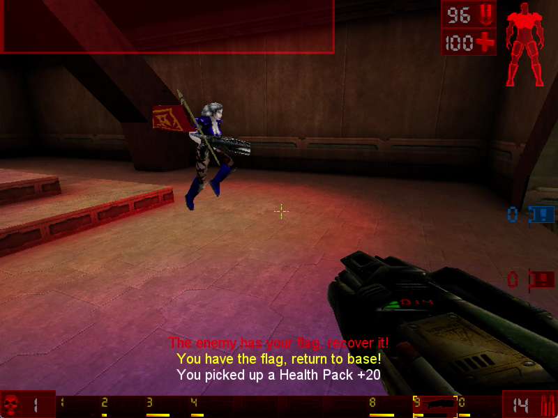

# Unreal Tournament — Static Recompilation

Static recompilation of **Unreal Tournament** (Epic Games / Digital Extremes,
1999) from its shipping Win32 binaries, the Steam build of v436, to native C.
The goal past running it is the makeover the pcrecomp family gave Gunman
Chronicles and Red Alert 2: its own modern presenter, widescreen and high
resolution done properly, and sharper rendering, built on the game's own code
rather than a reimplementation.

Built on the [pcrecomp](https://github.com/sp00nznet/pcrecomp) toolchain and
following its shared house style (layout, CLI, harness, headless mode).

This is not [OldUnreal's patch 469](https://www.oldunreal.com/). OldUnreal
maintains UT from Epic's source, with Epic's blessing, and ships modern
renderers and fixes for it. This project starts from the binaries the Steam
build ships and runs Epic's own machine code, recompiled; it is a pcrecomp
target first, and a different route to the same game.

## What the makeover adds

Everything here is built on the game's own code, recompiled; the original's
look is one setting away (*Mod > Recomp Graphics*, or the stock ini).

- **Widescreen, done properly.** A 16:9 window with a Hor+ field of view: the
  original's 4:3 picture, with more of the level at the sides instead of the
  top and bottom cut off. UT's own OpenGL renderer draws it, recompiled.
- **Anti-aliasing**: up to 8x multisampling, which UT's renderer never asked
  the driver for.
- **Sharper textures at a distance**: trilinear and up to 16x anisotropic
  filtering in place of the renderer's bilinear with the nearest mip.
- **Frame pacing**: a frame cap (200 by default; UT's physics go wrong far
  above that) and vsync.
- **HUD and menus for 1080p and up**: UT's HUD fonts stop growing at 1024
  pixels wide; ours scale with the resolution. The menus can run at twice
  the size.
- **Borderless fullscreen on Alt+Enter**, where UT's own mode switch fails on
  Windows 11. The window remembers its size.
- **WASD**: movement on W, A, S and D, jump on Space, crouch on Ctrl or C,
  set when Setup writes the launcher's ini (UT ships movement on the arrows).
  Keys you rebind in game stay; `py -3 tools\hd_ini.py --reset --classic-keys`
  goes back to UT's own.
- **Settings in the game's own menus**: *Mod > Recomp Graphics*, an
  UnrealScript window of ours, saved in the game's ini.
- **Steam or GOG**: either copy of the game (the same code, file for file).

## Status: **P1, playable.** Every module lifts with 0 errors. Played by hand in a 16:9 window: Deathmatch, Capture the Flag, Assault, a match to its end and the next map. The dedicated server runs and answers server-browser queries.

| Stage | State |
|---|---|
| P0: pick the build | Steam v436 (app 13240): `UnrealTournament.exe` wrapped in SteamStub 2.0, unwrapped statically; 12 DLLs, four rebased to fit ([RECON.md](docs/RECON.md)). GOG's GOTY 2.0.0.5 is the same code, its launcher already unwrapped |
| Function catalog (`tools/catalog.py`) | ~37,000 functions across 14 modules, 65-95% of each `.text`; no RTTI in this build, exports seed it |
| Lift (`run_lift.py`) | 38,674 functions, every module, **0 lift errors**; guest C++ exceptions caught and resumed (pcrecomp eh32); instructions lifted as nothing are counted, and the only one that still runs is Galaxy's SSE probe, which needs no result |
| Host (`build/ut99.exe`, 32-bit, pcrecomp `native32`) | maps every module at its base, binds guest-to-guest imports to lifted exports, runs each DLL's `DllMain` when the game loads it |
| Dedicated server (`--ucc -- server`) | **runs**: DM-Deck16][ up for play, the UnrealScript VM ticking, the query port answering (`tools/query.py`) ([bringup.md](docs/bringup.md)) |
| The game (`UnrealTournament.exe`, SoftDrv) | **plays**: the intro flyby as the original renders it, the main menu (UWindow), and a Deathmatch on DM-Deck16][ with four bots fighting, taunting and scoring, about 50 fps, driven by `--key` ([bringup.md](docs/bringup.md) 7-16); the HUD matches the original's |
| Headless mode | `--headless --record out.mp4 --frames N`: no window on any screen, the game's frames to ffmpeg at 30 fps; the game itself runs at about 55 fps in the software renderer |
| Conformance harness (`tools/conformance.py`, `netlab qa ut99-recomp`) | **11/11** boot milestones over three headless runs (intro, Deathmatch, dedicated server) and lift health, against `conformance.json` |
| HD makeover (OpenGlDrv + `src/runtime/glfx.c`, `mod/RecompMenu`) | **done for the launcher**: 16:9 window with Hor+ FOV, MSAA, anisotropic filtering, frame cap and vsync, scaled HUD fonts, 2x menus, borderless on Alt+Enter, settings in *Mod > Recomp Graphics* ([bringup.md](docs/bringup.md) 17-21) |

## Original vs recompiled

The same spawn on DM-Tutorial, the same camera. On the left, the shipping
`UnrealTournament.exe` on its own OpenGL renderer at 1440x1080 (4:3, the
original's 90 degrees). On the right, the recompiled game with the launcher's
settings at 1920x1080. The middle of the right picture is the left one; the
sides are what Hor+ adds. The HUD text is scaled to the resolution.



**Texture filtering**: the floor from the same two frames, 2x, brightened the
same on both sides. The original's bilinear blurs the far floor into a smear;
16x anisotropic filtering keeps its cracks and the joints between the slabs:



**Anti-aliasing**: the beam and its carving over the doorway, 3x, the
original's stair-stepped edges on the left, 8x MSAA on the right:



HUD fonts at 1920x1080: UT's own choice on the left, which stops at the
1024-pixel size, and ours, scaled, on the right:


## Screenshots

The recompiled game, software renderer, the intro flyby (640x480), recorded
headless (`--headless --record`) with nothing on any screen:


The main menu, and a Deathmatch on DM-Deck16][ against four bots:


| | |
|---|---|
|  |  |

UT's OpenGL renderer, recompiled, at 1600x900 with a Hor+ field of view (the launcher's settings):


The settings, in the game's own Mod menu (*Mod > Recomp Graphics*):


Capture the Flag, played by hand in a live window, software renderer (Facing Worlds, Coret):

| | |
|---|---|
|  |  |

UT's own Recovery Mode dialog, drawn by the recompiled Window.dll:


## Getting Started

You need **your own copy of Unreal Tournament**: the Steam build or GOG's GOTY
(the folder holding `System\UnrealTournament.exe`). The two ship the same
code, file for file, except that GOG's launcher is not wrapped in SteamStub;
one build runs either (conformance 11/11 on both). Nothing from the game is in this
repository and nothing is downloaded for you. The lifted C is generated on
your machine from your copy and is never distributed.

### Quick start

1. Download this repository (Code → Download ZIP) and unzip it anywhere.
2. Double-click **`Setup.cmd`**. It checks for Python, the Python packages,
   pcrecomp, Visual Studio, CMake and Ninja, and asks before installing
   anything that is missing. It finds Unreal Tournament in your Steam library
   or a GOG install (or asks for the folder), copies it into `game\` and sets it to start
   windowed, then unwraps, catalogs, lifts and builds. 40 to 80 minutes the
   first time; a rerun skips finished steps. If it stops, it says why in one
   sentence and keeps the details in `setup.log`.
3. Double-click **`Unreal Tournament (recomp).cmd`**: the game in a 16:9
   window in UT's OpenGL renderer, on its own `game\System\UTRecomp.ini`
   (`py -3 tools\hd_ini.py --reset 1920x1080` remakes it at another size).
   *Mod > Recomp Graphics* in the game's menu bar has the rendering settings.
   **Alt+Enter** switches to borderless fullscreen and back. Movement is on
   WASD (Options > Controls rebinds it as in the original).

### Step by step

Prerequisites: Windows 10/11, **Python 3.10+** (`py -3 --version`), **git**,
**Visual Studio 2022** (any edition, or the Build Tools) with *Desktop
development with C++* including the x86 tools, **CMake 3.20+** and **Ninja**,
and the pcrecomp toolkit cloned **beside** this repository as `tools`:

```
some-folder\
  tools\        <- git clone https://github.com/sp00nznet/pcrecomp tools
  ut99\         <- this repository
```

1. Python packages:
   ```
   py -3 -m pip install --user pefile capstone cryptography
   ```
2. Copy your install into `game\` (about 600 MB):
   ```
   robocopy "C:\Program Files (x86)\Steam\steamapps\common\Unreal Tournament" game /E /XD directx9c
   ```
3. Unwrap the launcher and move every module to its own base (seconds):
   ```
   py -3 tools\rebase.py
   ```
   Expected: one line per module, `UnrealTournament.exe   0x10900000-0x10963000` first.
4. The function catalogs (about 20 minutes; every module in parallel):
   ```
   py -3 tools\catalog.py
   ```
   Expected: a `Functions:` and `Byte coverage:` line per module, as in [RECON.md](docs/RECON.md).
5. Lift:
   ```
   py -3 run_lift.py
   ```
   Expected, last: `... functions in the dispatch table, lift errors 0`.
6. Build (from a plain terminal; `build.cmd` sets up the x86 compiler itself):
   ```
   build.cmd
   ```
7. Check the image maps and binds:
   ```
   build\ut99.exe
   ```
   Expected: a `[bind]` line per module, every one ending `0 unresolved`.
8. Run a dedicated server, and from a second terminal ask it what it is running:
   ```
   build\ut99.exe --run --ucc --headless -- server "DM-Deck16][?game=Botpack.DeathMatchPlus"
   py -3 tools\query.py
   ```
   Expected: `mapname     DM-Deck16][` and `gametype    DeathMatchPlus`.

The usual trip-ups: `python` opening the Microsoft Store (that is Windows' alias;
use `py -3`), and a PATH change that needs a new terminal window.

## Usage

```
build\ut99.exe                                   # dry run: map and bind every module
build\ut99.exe --run                             # the game
build\ut99.exe --run --ucc --headless -- server  # UCC: a dedicated server, no window
build\ut99.exe --run --msaa 8 --aniso 16       # OpenGL renderer: anti-aliasing, anisotropic filtering
build\ut99.exe --run --fps-cap 144 --vsync 1 --show-fps   # OpenGL renderer: frame pacing
build\ut99.exe --run --watchdog 60               # stop after 60 s with a report
build\ut99.exe --run --log                       # the engine's log on stderr as it is written
build\ut99.exe --run --headless --record menu.mp4 --frames 750 --key esc@12   # the intro, then the menu
py -3 tools\conformance.py                       # the harness: 11 milestones and lift health, ~3 minutes
build\ut99.exe --run --headless --record dm.mp4 --frames 1500 --key fire@8 --key fire@10 -- "DM-Deck16][?game=Botpack.DeathMatchPlus?numbots=4"
```

The shipping ini starts in fullscreen through DirectDraw at 640x480x16,
which fails on Windows 11 (the original faults on it). Setup.cmd sets it to
run windowed: under `[WinDrv.WindowsClient]` in
`game\System\UnrealTournament.ini`, `StartupFullscreen=False` and
`UseDirectDraw=False`. A run that crashed leaves `System\Running.ini`, and
the next start opens Recovery Mode; *Run Unreal Tournament* carries on.

Everything after `--` is the game's own command line. Diagnostics:
`--native-trace` (every call into Windows), `--callbacks`, `--probe VA`, and
with a `-DUT99_TRACE=ON` build `--calltrace FILE` and the other pcrecomp
trace options (`build\ut99.exe --help`).

## Building from source

Steps 5 and 6 above. `PCRECOMP` (environment, for the Python tools) and
`-DPCRECOMP=` (CMake) point at a toolkit checkout other than `..\tools`; the
lifter and the runtime must come from the same tree. Everything this game
needed from the toolkit is merged into pcrecomp's `main` (#52-#61: SteamStub
2.0, guest C++ exceptions, the x87 CRT helpers, `--native` bisection, the
bridge ABI fix, or/xor jcc and the MMX byte ops).

## Documentation

- [docs/RECON.md](docs/RECON.md): the build, the modules and their bases, SteamStub, the catalog
- [docs/bringup.md](docs/bringup.md): every wall so far and its fix
- [ROADMAP.md](ROADMAP.md), [CHANGELOG.md](CHANGELOG.md)

## License

MIT for this repository's own code ([LICENSE](LICENSE)). Unreal Tournament is
© Epic Games; none of its files, and nothing generated from them, is in this
repository.
