# Bring-up

Every wall so far, in the order they were hit, and what fixed it. The first
target is UCC's dedicated server (`ut99 --run --ucc --headless -- server
DM-Deck16][?game=Botpack.DeathMatchPlus`): no window and no renderer, but
Core, Engine, IpDrv, UWeb and the UnrealScript VM all run.

## 1. The launcher's code is encrypted

`UnrealTournament.exe` is wrapped in SteamStub 2.0; its first catalog found
0 call targets. Unwrapped statically by pcrecomp's `drm/steamstub.py`
(pcrecomp#52), called from `tools/rebase.py`. [RECON.md](RECON.md) has the
layout.

## 2. Map and bind

`build\ut99.exe` with no arguments maps every module at its base and binds
it. First run, all 13 bound with nothing missing:

```
[bind] 0x10300000: 14 native, 505 guest, 0 shimmed, 0 unresolved
...
[bind] 0x10900000: 109 native, 312 guest, 5 shimmed, 0 unresolved
```

"guest" is an import from another lifted module (Engine takes 505 from
Core), bound to that module's export so the call lands on lifted code.

## 3. "Can't resolve package name"

The first `--run --ucc` ran Core's `DllMain` and UCC's `main` into Core,
then died on a C++ throw:

```
=== C++ throw 0xE06D7363 at 0x76B41E54, thread 47092 ===
  thrown: Can't resolve package name
  in lifted sub_10170320 (Core.dll), last native call MSVCRT.dll!_CxxThrowException
```

That text is `Core.int`'s `PackageResolveFailed`, and the throw is not an
error: `UObject::StaticLoadObject` catches it itself and returns NULL. UCC
looks its commandlet up by trying class names, so the first miss throws. A
lifted guest throw went to the host's `_CxxThrowException`, whose SEH walk
knows nothing of the guest's frames.

Fixed in the toolkit: pcrecomp's eh32 (branch `feat/eh32`). The dispatch
reads only guest data (the `fs:[0]` chain, each frame's FuncInfo), runs the
unwind and catch funclets as guest code, and longjmps into a landing pad the
lifter gives every function with catch blocks. 56 functions across the
modules have one; most of this build's `guard`/`unguard` is compiled out.

One more piece was ours: a catch's resume address is reached only through
the funclet's return value, so the catalog often starts a function there and
cuts the parent short. `run_lift.py` takes resume points out of the function
walls and walks each one as a root of its parent's body.

## 4. UCC read the host's argv

With exceptions caught, UCC printed its banner and then:

```
Commandlet --run not found
```

UCC's `main(argc, argv)` gets argv from msvcrt's `__getmainargs`, which
parses the *process* command line: the host's. The host shims
`__getmainargs` with the guest's argv (everything after `--`).

## 5. A static constructor the catalog missed

The server then loaded every package and spawned its actors, and loading
`UWeb.dll` faulted:

```
Spawning: UWeb.WebServer
[load] UWeb.dll: DllMain
[callback] Windows called guest 0x10A03230, which is not lifted
```

`0x10A03230` is a static constructor named only by UWeb's `_initterm`
table. The function before it ends in a call that never returns, then 12
`nop`s of padding; disasm32 decoded on through the padding, so the data scan
saw the pointer land on an already-decoded instruction and skipped it as a
label. Fixed in the toolkit (pcrecomp branch
`feat/disasm32-nop-padded-entries`): a data pointer to a 16-aligned start
right after padding is an entry.

## 6. The dedicated server runs

With those, UCC's server comes all the way up and stays up:

```
Bringing Level DM-Deck16][.MyLevel up for play (20)...
Base Mutator is DM-Deck16][.DMMutator0
UdpServerQuery(crt): Port 7778 successfully bound.
Game engine initialized
```

and answers a server browser's query (`tools/query.py`) from its
UnrealScript query handler, through IpDrv:

```
hostname    Another UT Server
mapname     DM-Deck16][
gametype    DeathMatchPlus
numplayers  0
maxplayers  16
gamever     436
```

A 90-second run made 1.5 billion indirect calls (the VM's natives and
virtual dispatch) with no fault.

## 7. The launcher: Recovery Mode

`ut99 --run` (on an offstage virtual monitor) ran the launcher, attached every
DLL, and crashed in actor initialisation the first time. Every run after that
opened UT's own Recovery Mode dialog, drawn by the recompiled Window.dll:

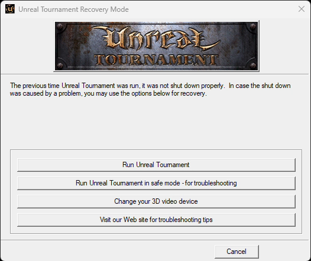

The launcher marks a session with `System\Running.ini` and deletes it on a
clean exit; a crash or a killed run leaves it. (`RunCount` in the ini is
only the splash rotation.) The host's watchdog now deletes the marker when it
stops a run on purpose; a real crash still leaves it.

`--log` prints the engine's log on stderr as it is written. Every module logs
through Core's exported `FOutputDevice::Logf`, so the host wraps that import;
UT's own log file is flushed only at exit and a killed run leaves it empty.

## 8. Galaxy's mixers are built at run time

The next crash was an execute fault at a heap address:

```
=== fault 0xC0000005 at 0x0CE0E81B, thread 59904 ===
  execute of 0x0CE0E81B
  region 0x0CDE0000+0xB0000 protect 0x4 type 0x20000
```

Those bytes are Galaxy's own mixer code (four templates in its `.text` start
with them): Galaxy copies the templates into `GlobalAlloc` memory, patches
them, and calls the copies. Heap memory was executable in 1999; under DEP it
is not. A static lift cannot contain code patched at run time, but the copy
is plain x86 working on guest memory in this address space, so the host
makes such a region executable on its first execute fault and the mixer runs
natively:

```
[log] Galaxy is using DirectSound
[log] Galaxy initialized
[gencode] guest-built code at 0x0D83023B: 0x0D830000+0x99000 made executable
[log] Game engine initialized
```

## 9. The intro renders

With that, the game loads the CityIntro map, starts the title music and the
software renderer draws the flyby in the game's window:

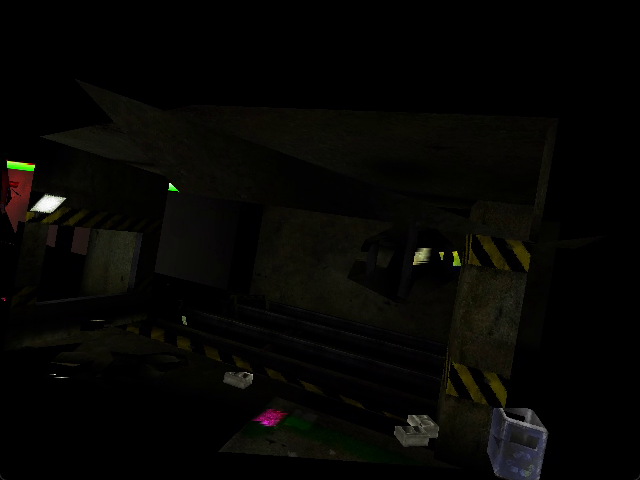

The shipping ini starts in fullscreen through DirectDraw at 640x480x16, and
that mode set fails on Windows 11 (`DirectDraw Failed 0x0x16:
DDERR_UNSUPPORTED`). The recompiled build carries on in the window; the
**original binary does not start at all** with that ini, it faults in
`UWindowsViewport::ddSetMode` (docs/RECON.md). Both are run windowed without
DirectDraw for comparison (`StartupFullscreen=False`, `UseDirectDraw=False`):
the original reaches the same corridor, and is as dark there, since the
intro is lit that way in the software renderer. A frame-exact comparison is
the conformance harness's job (ROADMAP).

## 10. Headless and --record

`--headless --record out.mp4 --frames N` runs with nothing on any screen:
top-level windows are layered at alpha 0, click-through and off the taskbar,
so Windows still paints them; the game's mouse capture is kept off the real
cursor. WinDrv draws each frame by `BitBlt` from the render device's DIB, and
the shim copies that into the recorder's own top-down 32-bit DIB (GDI handles
the source's row order and pixel format: reading the DIB by hand came out
upside down). A thread sends the newest frame to ffmpeg at 30 fps.

```
[record] 640x480 at 30 fps to work\runs\hl.mp4
[record] 900 frames written; the game drew 1646
```

## 11. Every float-to-int cast returned 0x80000000

The first headless videos crawled through the first corridor for 30 seconds,
where the original's flyby sweeps through the whole city. The log had said so
from the start:

```
[log] Startup time: -2147483648.000000 seconds
```

UT's clock (`FTime`) is 32.32 fixed point: seconds times 2^32, converted
to a 64-bit integer. MSVC 6 compiles every float-to-integer cast as
`call _ftol`, and every module imports `_ftol` from msvcrt.dll. `_ftol`
takes its argument in the x87's st(0); native32's bridge passes stack
arguments only, and lifted code keeps its FPU stack in `g_st`, so the native
`_ftol` read whatever the real FPU held and returned the integer indefinite.
Every timestamp was `0x8000000000000000`, every frame delta nothing.

Fixed in the toolkit (pcrecomp branch `feat/native32-x87-crt`): `_ftol` and
the `_CI*` intrinsics (`_CIpow`, `_CIfmod`, `_CIacos`, ...) are native32
built-ins working on the lifted FPU stack, and `_controlfp`/`_control87`
copy the control word they set into the lifted one.

```
[log] Startup time: 1.402504 seconds
```

The flyby then follows the original's route, at about 55 frames a second.

## 12. The renderer drew shards: bisected to one function

With the clock right, the flyby followed the original's route, but the
picture was wrong: polygons stretched across the screen and drawn over each
other, no sky. The original (windowed, recorded the same way) was clean.

Two toolkit additions found it without reading a line of the renderer:

- `--native Render.dll` runs that module's original machine code among the
  lifted ones (pcrecomp `native32_set_native`): clean. SoftDrv native: still
  broken. So the bug was in Render.dll's lift.
- `--lift-in-native FILE` lifts chosen functions of a native module after all
  (`native32_lift_in_native`: their entries become `ud2`, and the trap goes to
  the lifted body). `tools/find_bad_function.py` halves the set until one
  function is left, scoring each headless run by how close its frames come to
  any frame of an all-native run (the flyby takes the same path, so a clean
  frame has a near twin whatever the frame rate):

```
all native 99.2, all lifted 251.2
step 0: 582 functions lifted, score 249.6 -> broken: the bad one is among them
...
step 9: 1 functions lifted, score 239.4 -> broken: the bad one is among them
the function that breaks Render.dll: sub_10B01203
```

`0x10B01203` is an incremental-link thunk (Render.dll was linked with
`/INCREMENTAL`) for the vertex transform and clipper at `0x10B159A0`.

## 13. `xor; jge` was always taken

The clipper decides whether an edge crosses a plane by the signs of two
distances, stored as floats and read as integers:


lifted as


`or` and `xor` keep their result in both flag slots, and `CMP_GE(r, r)` is
always true: no edge ever crossed a plane. lift32 had a note saying ordering
jumps after `or`/`xor` were approximate; they now use `test`'s table, which is
exact for a result held in both slots (pcrecomp `fix/lift32-or-xor-jcc`, four
difftest cases, 206/206). With the whole game relifted:

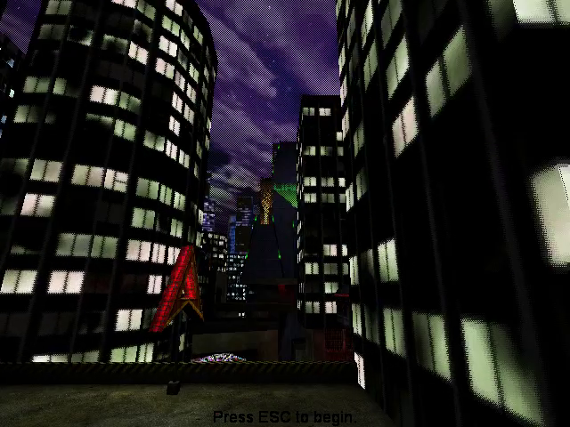

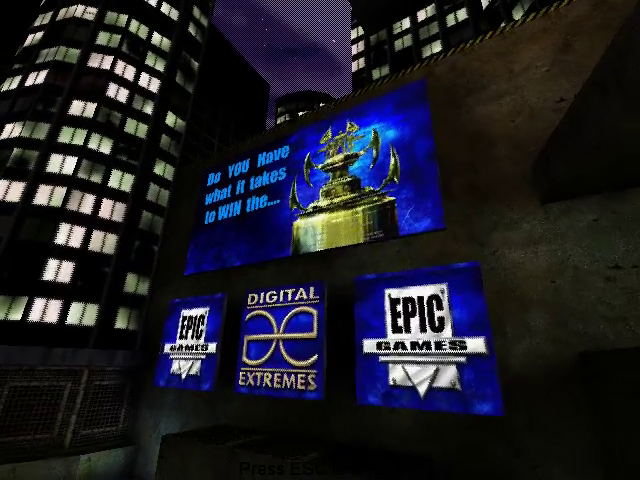

## 14. The menu, and scripted input

`--key VK@S` (`esc`, `enter`, arrows, `fire`, `altfire`, or a number) posts
the key, or a click in the middle of the viewport, to the window the frames
are blitted to, S seconds in. ESC on the intro opens the main menu: UWindow,
the UnrealScript interface, drawn by the recompiled engine:

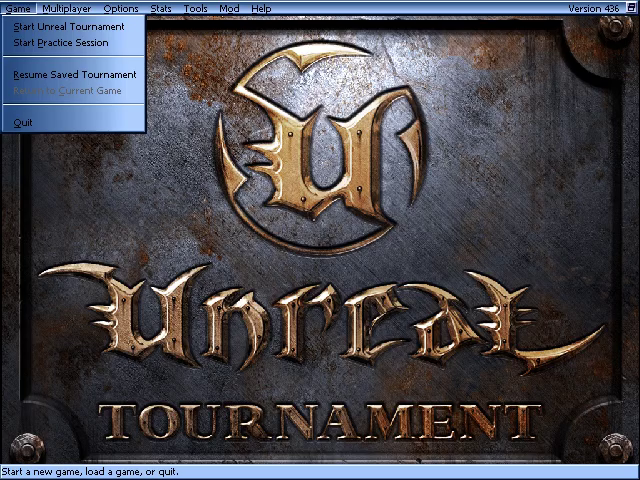

## 15. A Deathmatch with bots

A map URL on the game's own command line starts a match directly:

```
ut99 --run --headless --record dm.mp4 --frames 1500 --key fire@8 --key fire@10 -- "DM-Deck16][?game=Botpack.DeathMatchPlus?numbots=4"
```

The first runs died with no report when the player fired. Windows' own
crash record named the host: `ut99.exe` + 0x4E57, inside native32's bridge,
just after a native call. Two causes, both fixed in the toolkit:

- Fire.dll (procedural textures) calls three routines at 0x10815DC0,
  0x10816540 and 0x10816DB0, which are in its `.data`: hand-written asm kept
  in writable memory, which patches itself. A call into a module outside its
  code sections now runs natively, the section made executable once
  (pcrecomp `feat/native32-native-modules`).
- That asm returns with `ebx` and `ebp` changed: it was only ever called from
  inline asm that saved everything. The bridge kept its esp anchor in `ebx`
  and its locals behind the frame register; it now saves both and keeps the
  anchor in the thread's TEB (`fix/native32-bridge-callee-clobbers`).

With those the match plays: the HUD, weapons, damage, the bots fighting,
taunting and scoring (2,422 frames drawn in 50 s):

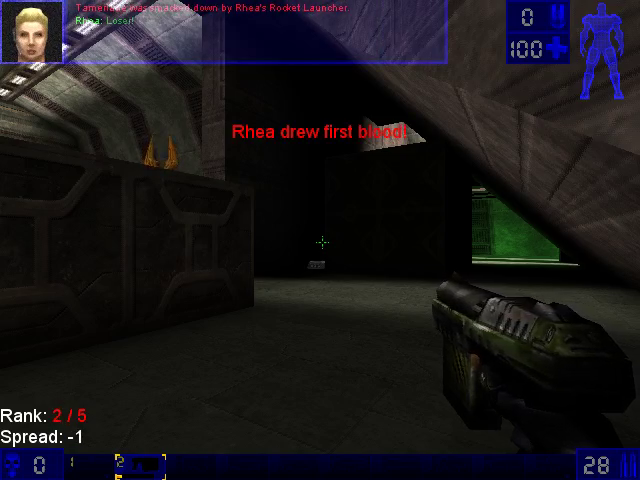

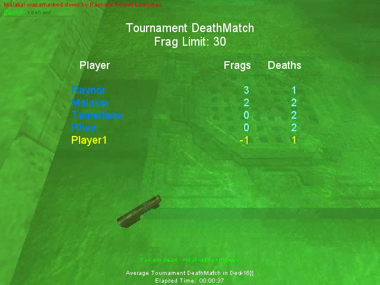

## 16. The HUD's black box: an MMX op lifted as nothing

The HUD's top-left was a solid black box for most of a match. A reference
run of the original, in the same match, says what belongs there: the speech
area, a translucent panel (the world shows through it) with the speaking
bot's face. The original runs windowed on an offstage monitor;
`tools/click_original.py` posts it the same clicks `--key fire@S` gives the
recompiled game:

```
start py -3 tools\click_original.py 14 17 20
offstage run --size 1280x720 --record ref.mp4 -- work\ref\System\UnrealTournament.exe "DM-Deck16][?game=Botpack.DeathMatchPlus?numbots=4"
```

Botpack.u carries its UnrealScript source, and `ChallengeHUD.DrawSpeechArea`
draws the panel every frame, `STY_Translucent`, in `HUDColor *
MessageFadeTime`: with no message showing, translucent black, which adds
nothing. Ours drew it opaque, so black.

`--native SoftDrv.dll` made the box go away; SoftDrv native with only
`DrawTile` lifted (`--lift-in-native`, one address) brought it back. Its
translucent span loop is one MMX instruction per pixel, `paddusb mm1, mm2`
(texel plus screen, each channel stopping at 255), and the lift had it as

```c
; /* UNIMPLEMENTED: paddusb mm1, mm2 */
```

so the texel was stored alone. lift32 had MMX's word and dword ops but not
its byte or unsigned-saturating ones: 6,801 `paddusb` sites in SoftDrv, all
silent, and the lift still said 0 errors. pcrecomp `feat/lift32-mmx-byte-ops`
adds those thirteen, and `run_lift.py` now prints every instruction lifted as
nothing, per module. What is left never runs lifted: Galaxy's SSE and
3DNow! mixers (it runs patched copies of them from its heap, natively; with
the twelve trapped under `--native Galaxy.dll --lift-in-native`, only its
SSE probe, a `movaps` inside a try, is ever entered), and a few decodes of
data (`das`, `arpl`, `bound`).

The original, then the recompiled game, both at a bot's first frag:

| | |
|---|---|
| 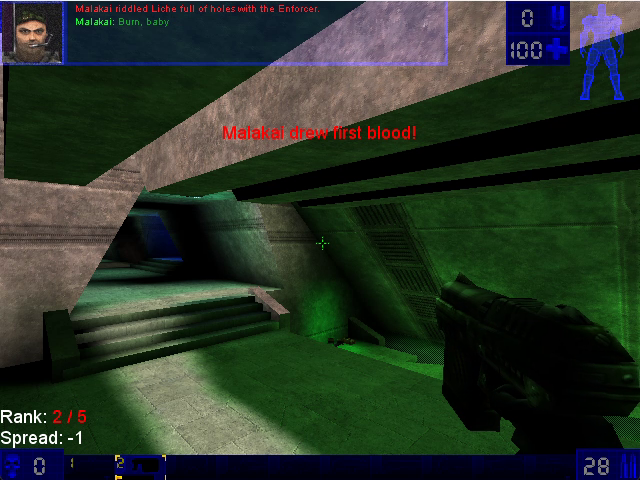 |  |

## 17. Played by hand, then the hardware renderer

The launcher, at the console: mouse look and the keyboard through WinDrv as
it is, Capture the Flag on Facing Worlds, Coret and Command, a match to its
end, the next map, a clean quit. Nothing in the host changed for it. The
software renderer at 800x600 felt slow.

UT's own OpenGL renderer (`OpenGlDrv.dll`), lifted with the rest since the
start, runs as it is: it loads `opengl32` through `LoadLibrary` and
`GetProcAddress`, the host hands it the real driver, and every GL call from
lifted code is an indirect call into native code through the bridge. On an
RTX 5070 (GL 4.6) it draws the intro and a Deathmatch at 1600x900 as the
original's OpenGL renderer does: filtered textures, 32-bit colour, the HUD
translucent.

The launcher runs it on its own ini pair, so the stock ini stays on the
software renderer that headless capture and the conformance harness read
from: `tools/hd_ini.py` writes `UTRecomp.ini` (OpenGL, a 16:9 window at 80%
of the screen) and `UTRecompUser.ini` (a Hor+ field of view: UT's 90 degrees
is horizontal at 4:3, so 106.26 at 16:9 keeps the vertical view), and the
launcher passes them as `INI=` and `USERINI=`.

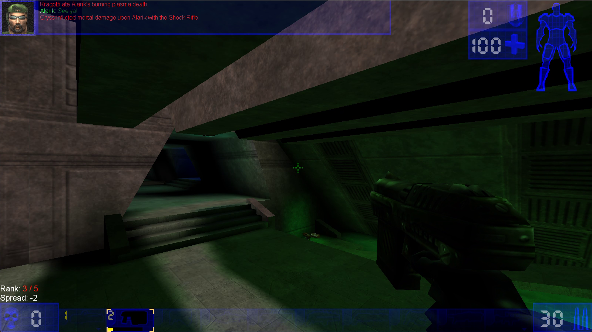

Not yet compared: the pre-match spectator camera once showed a black wedge
over half the view in OpenGL; the original's camera started somewhere else
that run.

Played by hand on the launcher's OpenGL settings: Assault on Overlord (twice,
both sides) and Guardia, and the start of the ladder, in a 16:9 window,
with no slowness. The software renderer's slowness was the CPU drawing
800x600, not the host.

## 18. Anti-aliasing and anisotropic filtering, from the host

OpenGlDrv finds every GL, WGL and pixel-format function with
`GetProcAddress`, and the host already answers that call for every guest
module, so it hands the renderer a wrapper for three of them
(`src/runtime/glfx.c`, off unless asked for):

- `--msaa N`: `SetPixelFormat` gets a multisample format with N samples from
  `wglChoosePixelFormatARB` (found once through a throwaway window and
  context). UT asks for 32-bit depth, which no multisample window format on
  the RTX 5070 has; the ARB attribute is a minimum, so 24.
- `--aniso N`: a mipmapped texture's minification filter becomes trilinear,
  with N-times anisotropic filtering, in place of OpenGlDrv's bilinear with
  the nearest mip.

The launcher passes `--msaa 8 --aniso 16`. The same pre-match frame, 4x, the
game's own pixel format and then 8x multisampling:

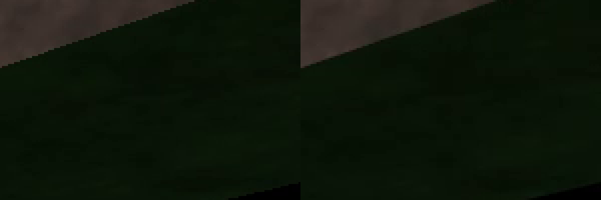

## 19. Frame pacing

OpenGlDrv gets `SwapBuffers` from GDI32 the same way, so the host wraps it
too: `--vsync 0|1` sets the swap interval on the first frame, `--fps-cap N`
holds the rate to N (sleeping in 1 ms steps, then spinning the last 2 ms),
and `--show-fps` prints the rate every 5 s. In a Deathmatch at 1536x864
with 8x MSAA on the RTX 5070, on a machine shared with other work:
uncapped, 85 to 218 fps and never steady; `--fps-cap 120`, 117.4 to 120.2.
UT's physics and input go wrong at very high frame rates, so the launcher
passes `--fps-cap 200` and leaves vsync to the driver.

## 20. The settings in the game's menus, and HUD fonts for 1080p

The Video page can't take more rows without changing a file of the game's:
`UMenuVideoScrollClient` names `UMenuVideoClientWindow` outright, where pages
like Audio are found by name. UT's own way in is the **Mod menu**, which
lists every class an `.int` file declares with
`MetaClass=UMenu.UMenuModMenuItem`. `mod/RecompMenu` is ours, in
UnrealScript: *Mod > Recomp Graphics* opens a window with anti-aliasing,
texture filtering, the frame cap, vsync, HUD fonts and menu size.

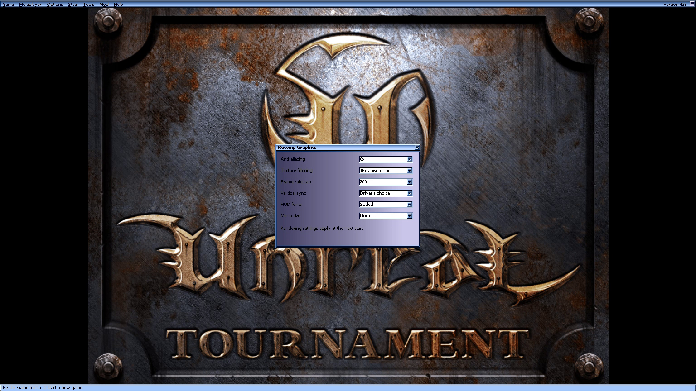

The first four are the host's. The window saves them under
`[RecompMenu.RecompGraphicsClient]` in the game's ini, and the host reads
that section from whichever ini `-INI=` names before the game starts
(`glfx_config`); a command-line flag still wins. The launcher passes no
flags now. Its ini arguments became `-INI=` and `-USERINI=`: without the
dash, a start with no map took `INI=UTRecomp.ini` for the map URL, looked it
up as a host name and fell back to the intro.

HUD fonts: Botpack's `FontInfo` picks bigger LadderFonts up to 1024 pixels
wide and stops, so at 1080p the HUD's text is what it is at 1024x768.
`ChallengeHUD.FontInfoClass` is a config string, and `RecompFontInfo`
scales each size by width/1280 from there, up to the largest LadderFont (30
point; very high resolutions still stop at 30). Menu size is UWindow's own
`GUIScale` (2: the menus at double size with Tahoma 20 and 30). The
original fonts and the scaled ones at 1920x1080:

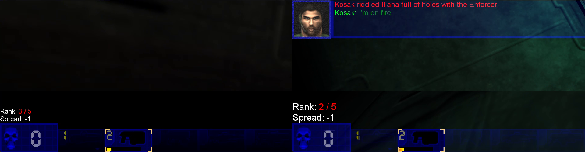

`RecompMenu.u` is built on the player's machine by `tools/build_mod.py`
(Setup step 8): our source compiled by the game's own `UCC.exe make`, run
natively as a tool, since `make` needs `Editor.dll`, which is not lifted.
The stock packages are not touched (UMenu.u stays byte-identical to the
Steam copy). `tools/uscript.py` prints the UnrealScript a package carries,
which is how the window's calls into UWindow were found.

## 21. Borderless fullscreen on Alt+Enter

UT's own Alt+Enter changes the display mode, which is what fails on Windows
11; F11 is its Brightness key. The host takes Alt+Enter: on the first frame
drawn (the `SwapBuffers` wrapper), it subclasses the game's window, and
Alt+Enter turns it into a popup over its monitor and back. WinDrv's window
procedure sees the resize as any other, and the OpenGL viewport follows: the
HUD and scoreboard lay out at the monitor's size.

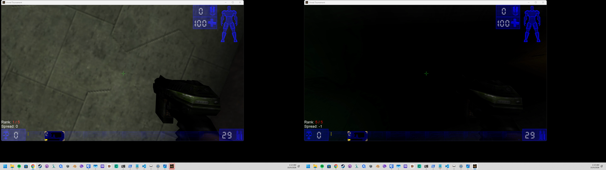

The state is kept in `System\RecompHost.ini`, a file the game never writes:
UT rewrites its ini from its own cache on the way out, and keys the host
added to it while it ran did not survive. Quitting borderless leaves the
monitor's size as the game's window size, so the host also keeps the
windowed size it had, and puts it back into the game's ini at the next start,
before the game reads it.

